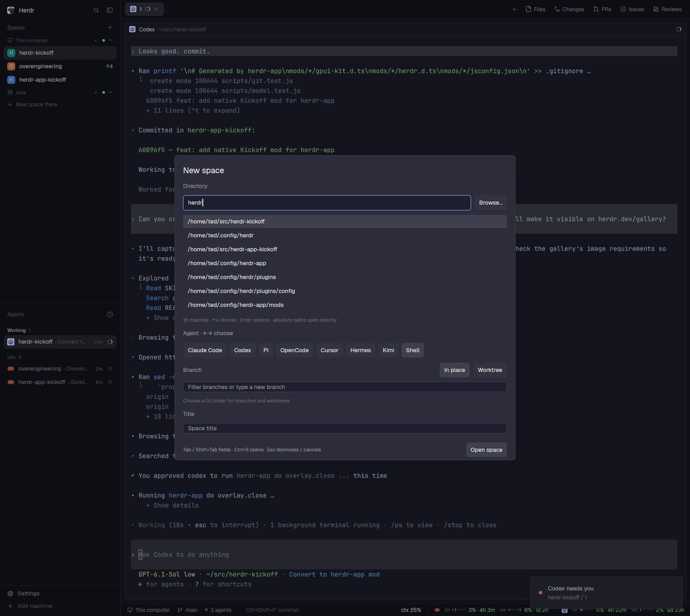

# Kickoff for herdr-app

A keyboard-first herdr-app dialog that opens a folder as a new space, with your chosen agent, on the branch or worktree you want.



This is a native herdr-app mod. It is a separate project from the Rust [herdr-kickoff](https://github.com/tedkulp/herdr-kickoff) plugin.

- **Pick a folder fast**: filter your zoxide history, type a path, or use the native folder picker.
- **Pick an agent**: any installed agent from herdr-app's program table, or a plain shell. Your last choice is remembered.
- **Pick a branch**: switch the checkout in place, or open the branch in its own Git worktree.
- **No mouse needed**: every field, picker, and the launch itself has a key.

## Requirements

- herdr-app
- Git, for branch and worktree features
- [zoxide](https://github.com/ajeetdsouza/zoxide), optional. Without it, type a path or use Browse.

## Install

1. Link the mod into herdr-app's mods folder. The destination must not already exist.

   ```sh
   ln -s "$PWD/mods/herdr-kickoff" "${HERDR_APP_HOME:-$HOME/.config/herdr-app}/mods/herdr-kickoff"
   ```

2. Bind a key in the `global` object of herdr-app's `keys.json`:

   ```json
   "ctrl-shift-n": "mod.open:herdr-kickoff"
   ```

   The default `keys.json` already binds `ctrl-shift-n` to `space.new`. Replace that line to make Kickoff your new-space dialog, or pick a different key.

## Usage

Press your key. The dialog has four fields: **Directory**, **Agent**, **Branch**, and **Title**.

1. **Directory**: type to filter zoxide history, or enter an absolute path or `~/path`. Every word must match, case is smart (any capital letter makes the match case-sensitive), and zoxide's ranking is kept.
2. **Agent**: use the arrow keys to choose.
3. **Branch**: type to filter local branches. A name with no match creates a new branch. Clear the text to see every branch.
4. **Title**: defaults to `folder` or `folder:branch` and follows your choices until you edit it.

### Keys

| Key | Action |
| --- | --- |
| <kbd>Tab</kbd> / <kbd>Shift+Tab</kbd> | Next / previous field |
| <kbd>↑</kbd> <kbd>↓</kbd>, <kbd>Enter</kbd> | Move through a picker, select |
| <kbd>←</kbd> <kbd>→</kbd> | Change agent (on Agent) |
| <kbd>Ctrl+W</kbd> or <kbd>Alt+←</kbd> / <kbd>Alt+→</kbd> | Toggle In place / Worktree (on Branch) |
| <kbd>Ctrl+S</kbd> or <kbd>Ctrl/Cmd+Enter</kbd> | Open the space from any field |
| <kbd>Enter</kbd> on Title | Open the space |
| <kbd>Esc</kbd> | Close an open picker, then close the dialog |

### In place vs. Worktree

- **In place** switches the repository's checkout to the chosen branch, then opens the space there. If Git refuses (for example, uncommitted changes would be overwritten), the error stays in the dialog and nothing changes.
- **Worktree** reopens an existing worktree for the branch, or creates one at `~/.herdr/worktrees/<repo>/<encoded-branch>`. If a local space is already open on that worktree, Kickoff selects it instead of starting another agent.

New branches start from the repository's default branch (`origin/HEAD`), falling back to `main`, `master`, or `HEAD`.

Spaces always open on this computer, never a remote machine.

## Develop

Requires Node.js 22 or later and a Unix-like system. There are no npm dependencies or build steps.

```sh
npm run check
```

This runs a syntax check, the unit and Git integration tests, and `herdr-app check` on the mod. Before releasing, also try Browse, agent selection, an invalid folder, and a real launch in the app.

| File | Owns |
| --- | --- |
| `mods/herdr-kickoff/main.js` | The dialog, keyboard navigation, async discovery, and host calls |
| `mods/herdr-kickoff/model.js` | Filtering, key mapping, default titles, launch argument validation |
| `mods/herdr-kickoff/git.js` | Repository inspection and branch/worktree setup, with an injected process runner |

The Git tests in `scripts/` run against real temporary repositories, never your own.

## License

[MIT](LICENSE)

## Gallery

[RECIPE.md](RECIPE.md) describes how to rebuild the mod. The root folder includes `preview.png`, the `mods/herdr-kickoff/` sources, and a [keys.json snippet](keys.json). Merge that snippet into your existing keys; it replaces the default Ctrl+Shift+N binding.

The [Herdr gallery](https://herdr.dev/gallery/) discovers public GitHub repositories with the `herdr-mod` topic. Gallery updates can take an hour, and community images are screened before appearing.
