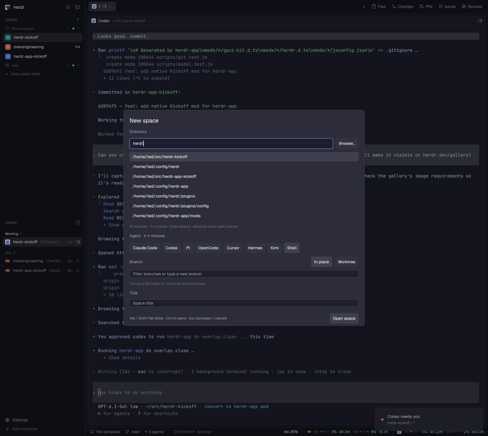

# Kickoff

Build a keyboard-first dialog for starting work in a local folder with a chosen coding agent. It combines zoxide directory history, an agent selector, branch selection, In place and Worktree modes, and an editable space title.

## What you see

A centered 760 × 680 logical-pixel dialog uses the app's theme colors. An 18-pixel semibold heading says "New space". The body uses 13-pixel text, 18-pixel padding and 10-pixel gaps.

From top to bottom, show Directory with an input and Browse button; directory matches while picking; Agent as a wrapping row of installed-agent buttons plus Shell; Branch with In place and Worktree buttons and a text input; matching branches while picking; a default-branch hint; and Title. The footer shows keyboard help and Open space. Inputs have a background, rounded corners, and a border in the accent color when their field is active. Selected rows and choices use the selected theme color.

Show at most seven matching picker rows around the selected result. Mark checked-out branches with "⎇ worktree". Use muted text for hints and the blocked color for errors. The footer button says "Opening…" during launch.

## How it behaves

- Load `zoxide query --list` asynchronously. Match every space-separated term as a substring, preserve ranking, and make a term case-sensitive when it contains uppercase letters. Missing zoxide leaves direct absolute paths, `~/path`, and Browse available.
- Start with Directory focused. Up/Down changes the picker selection; Enter picks a directory. An absolute path is accepted directly. Browse opens the system folder picker.
- Tab and Shift+Tab move through Directory, Agent, Branch, and Title. Arrow keys on Agent select an installed agent or Shell. Remember the last choice across openings.
- Inspect the selected folder asynchronously. Show the current local branch first, followed by local branches ordered by most recent commit. Clear Branch to see all branches; typing filters them. Enter picks a matching branch; no match means a new branch name.
- On Branch, Ctrl+W or Alt+Left/Right toggles launch mode. In place switches branches before creating a space. Worktree reuses a checkout or creates one under `~/.herdr/worktrees/<repo>/<encoded-branch>`. New branches start from origin/HEAD, falling back to main, master, then HEAD.
- Refuse an in-place switch to a branch checked out elsewhere. Let Git reject switches that would overwrite local changes, and retain its error in the dialog. Do not launch after a Git failure.
- Reopening an already-open local worktree selects its space without starting another agent. Otherwise create a local space with the selected agent's argument vector, or let the core choose its default shell.
- Default the title to the folder name, adding the branch for Worktree or an in-place branch change. Stop updating it once the person edits it.
- Ctrl+S or Ctrl/Cmd+Enter launches from any field. Enter on Title launches. Escape dismisses a picker, then closes the dialog. Block duplicate launches while opening.
- This launcher does not display agent working, blocked, done, or idle states. It lists available launch programs, rather than running sessions.

## Built from

Use `mods/herdr-kickoff/main.js` as a default-exported `View` with `div`, `v_flex`, `h_flex`, `InputState`, and `Input` from gpui-kit and gpui-base. Set `place` to `none` and declare the dialog dimensions in `mod.json`. The host supplies `props().overlay` for closing.

Use `knownAgents`, `exec`, `pickFolder`, `home`, `theme`, `shared`, `setShared`, `spaces`, `panes`, `run`, and `closeOverlay` from `herdr`. Persist the last agent under `herdr-kickoff.last-agent`. Open with `mod.open:herdr-kickoff`; launch with `space.new`, explicitly passing `machine: ""`; reuse with `space.select`.

Keep filtering, key-action mapping, title defaults, and launch-argument validation in `model.js`. Keep Git inspection and preparation in `git.js`, accepting an injected process runner so tests can use real subprocesses. Run Git with argument arrays and parse NUL-delimited worktree output. Use `test -d` to validate the chosen directory. This is a native mod without a Node runtime dependency; Node runs development tests only. The preview is a real app screenshot, with no additional art assets.

## Watch out

- The implementation targets Unix-like local paths and local machines. A focused remote space must not redirect the launch.
- Give Enter one owner. Handling both an input's submit event and the root key event can advance two fields on one press.
- Keep host calls in View initialization and callbacks. Use each callback's own context; asynchronous results from an old directory selection must not overwrite newer state.
- Encode branch names in worktree directory names so slashes and dashes do not collapse to the same path. Existing destination conflicts should report Git's error.
- Merge `keys.json` into the user's configuration. Ctrl+Shift+N normally creates a space, so the snippet replaces that binding.
- `herdr-app check` only covers the initial render. Test later discovery, picker states, focus, and Git failures in the running app.

## Done when

1. `npm run check` passes the syntax check, unit tests, temporary-repository Git integration tests, and native mod check.
2. Typing a directory filter shows ranked zoxide matches and Enter advances once to Agent.
3. Without the mouse, select an agent, reach Branch, toggle Worktree, reach Title, and launch.
4. A new worktree branch starts from the default branch; reopening it reuses its path and an existing local space when present.
5. An unsuccessful branch switch leaves dirty files intact, shows an error, and launches nothing.
6. With zoxide unavailable, an absolute path or Browse still works.
